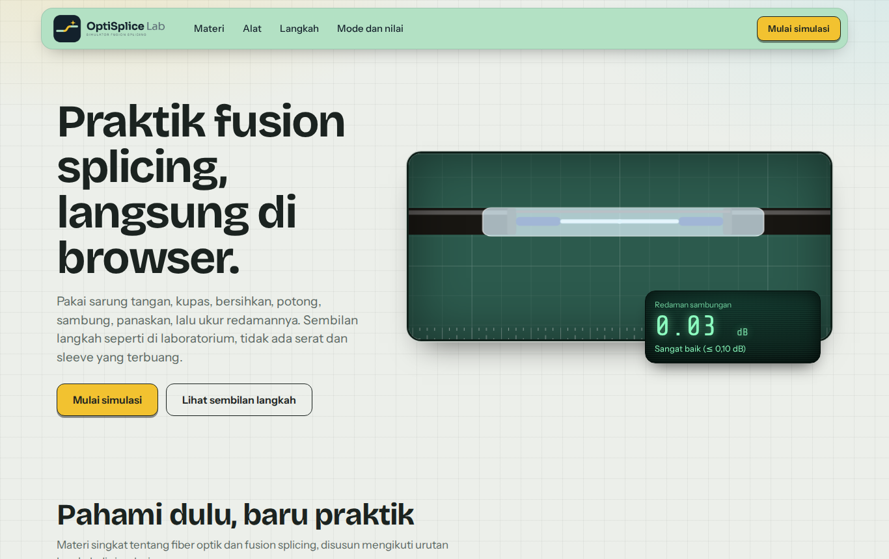
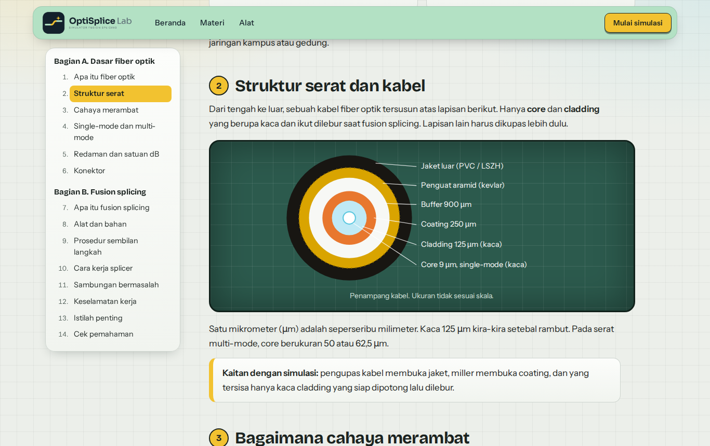
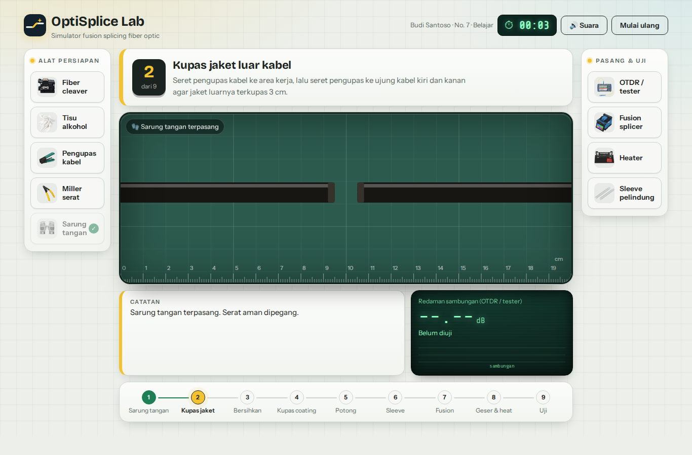
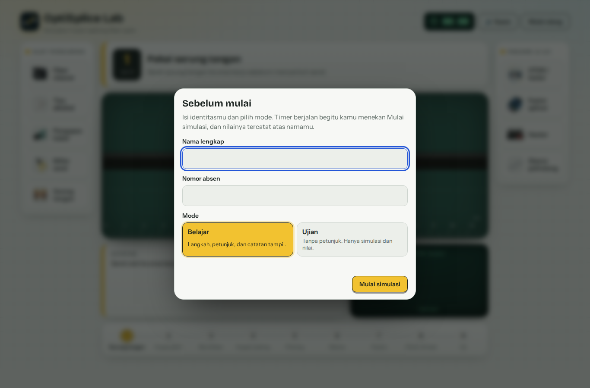
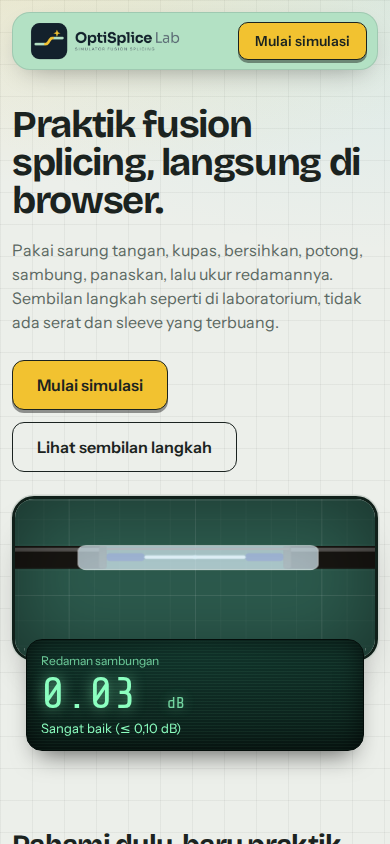
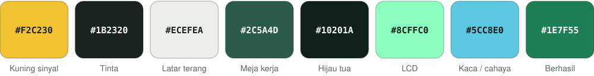

<div align="center">



<br>

**Simulator praktikum fusion splicing fiber optik yang berjalan langsung di browser.**
Seret alat, kupas, bersihkan, potong, sambung, panaskan, lalu ukur redamannya.
Sembilan langkah seperti di laboratorium, tanpa serat yang terbuang.

<br>


[Tentang](#tentang) ·
[Tangkapan layar](#tangkapan-layar) ·
[Fitur](#fitur) ·
[Alur simulasi](#alur-simulasi) ·
[Penilaian](#penilaian-dan-bukti) ·
[Menjalankan](#menjalankan) ·
[Kustomisasi](#kustomisasi)

</div>

---

## Tentang

**OptiSplice Lab** adalah media pembelajaran interaktif untuk siswa dan mahasiswa jaringan komputer dan fiber optik. Siswa tidak membaca prosedur lalu menjawab soal. Siswa **mengerjakan** prosedurnya: memilih alat, menyeretnya ke area kerja, menunggu mesin bekerja, lalu membaca hasil ukur redaman.

Proyek ini terdiri dari tiga halaman statis:

| Halaman | Berkas | Isi |
|---|---|---|
| Beranda | `index.html` | Pengenalan, daftar materi, papan alat, langkah, mode dan nilai |
| Materi | `materi.html` | 14 topik: dasar fiber optik dan fusion splicing, lengkap dengan cek pemahaman |
| Simulasi | `simulasi.html` | Praktikum sembilan langkah dengan nilai dan bukti JPG |

Semuanya HTML, CSS, dan JavaScript murni. Tidak ada framework, tidak ada proses build, dan tidak ada server atau database.

## Tangkapan layar

<table>
  <tr>
    <td width="50%"><br><sub><b>Beranda.</b> Animasi penyambungan di meja kerja, lengkap dengan layar LCD redaman.</sub></td>
    <td width="50%"><br><sub><b>Materi.</b> Daftar isi yang mengikuti bacaan, diagram SVG, dan tabel.</sub></td>
  </tr>
  <tr>
    <td width="50%"><br><sub><b>Simulasi.</b> Rak alat, area kerja berpenggaris, meter OTDR, dan rel sembilan langkah.</sub></td>
    <td width="50%"><br><sub><b>Sebelum mulai.</b> Siswa mengisi nama, nomor absen, dan memilih mode.</sub></td>
  </tr>
</table>

<p align="center"><br><sub><b>Ponsel.</b> Tata letak beranda menyesuaikan layar kecil.</sub></p>

## Fitur

**Simulasi**

- Alat **diseret** ke area kerja. Di layar sentuh, ketuk alat lalu ketuk area kerja.
- Posisi alat di rak **diacak setiap sesi**, jadi siswa harus tahu alat mana untuk langkah mana.
- Salah memilih alat dicatat sebagai kesalahan dan mengurangi nilai.
- Mesin fusion splicer dan heater punya dialog sendiri. Hasil ukur ditampilkan di layar LCD bergaya meter OTDR.
- Efek suara dibuat dengan Web Audio API. Tombol **Suara** mengatur bunyi, dan pilihannya diingat di browser.
- Rel langkah, panel instruksi, dan catatan kegiatan menuntun siswa di mode belajar.

**Pembelajaran**

- Halaman materi dengan dua bagian dan 14 topik, ditulis mengikuti urutan langkah di simulasi.
- Diagram SVG penampang kabel dan pemantulan cahaya, tabel perbandingan, contoh anggaran redaman, tabel sambungan bermasalah, dan lima soal cek pemahaman.

**Penilaian**

- Dua mode: **belajar** dan **ujian**.
- Nilai 0 sampai 100 dengan huruf A sampai D.
- Bukti hasil yang bisa diunduh sebagai **JPG** dengan ID unik.

**Teknis**

- Tema terang dan gelap otomatis mengikuti pengaturan perangkat.
- Responsif dari ponsel sampai layar lebar.
- Menghormati pengaturan `prefers-reduced-motion`.
- Satu-satunya data yang disimpan di browser adalah pilihan suara (`localStorage`).

## Alur simulasi

| # | Langkah | Alat | Yang dikerjakan |
|---|---|---|---|
| 1 | Pakai sarung tangan | Sarung tangan | Perlindungan diri sebelum menyentuh serat |
| 2 | Kupas jaket luar | Pengupas kabel | Jaket terkupas 3 cm di kedua kabel |
| 3 | Bersihkan serat | Tisu alkohol | Gel dan kotoran dihilangkan |
| 4 | Kupas coating | Miller serat | Kaca cladding terbuka 15 mm |
| 5 | Potong serat | Fiber cleaver | Ujung serat rata, sudut mendekati 0° |
| 6 | Pasang sleeve | Sleeve pelindung | Wajib sebelum serat disambung |
| 7 | Fusion | Fusion splicer | Serat dijepit, disejajarkan, lalu dilebur dengan busur listrik |
| 8 | Geser sleeve dan panaskan | Heater | Sleeve tepat di sambungan, lalu menyusut |
| 9 | Ukur redaman | OTDR / tester | Redaman ditampilkan dalam dB. Batas lulus 0,30 dB |

Urutan langkahnya tetap. Posisi alat di rak yang diacak.

## Penilaian dan bukti

Nilai dihitung otomatis di `js/sesi_siswa.js`.

| Komponen | Poin | Aturan |
|---|---|---|
| Prosedur lengkap | 50 | Semua sembilan langkah selesai |
| Ketepatan alat | 30 | 30 dikurangi 5 poin untuk setiap kesalahan, minimal 0 |
| Kecepatan | 20 | Penuh jika selesai dalam 3 menit, turun merata sampai 0 di menit ke-10 |

| Nilai | Huruf | Keterangan |
|---|---|---|
| 90 ke atas | A | Sangat baik |
| 80 ke atas | B | Baik |
| 70 ke atas | C | Cukup |
| Di bawah 70 | D | Perlu mengulang |

**Dua mode**

- **Belajar:** langkah, petunjuk, dan catatan tampil di layar.
- **Ujian:** petunjuk, catatan, rel langkah, ukuran, dan notifikasi disembunyikan. Yang tersisa hanya area kerja, timer, dan nilai.

**Bukti JPG.** Setelah selesai, siswa dapat mengunduh `Bukti-Simulasi_<absen>_<nama>.jpg` berisi nama, nomor absen, mode, tanggal, durasi, nilai, rincian nilai, daftar sembilan langkah beserta waktu pengerjaan tiap langkah, redaman terukur, dan **ID bukti** berawalan `OSL-`. ID dibuat dari nama, absen, waktu, dan nilai. Fungsinya sebagai penanda, bukan tanda tangan digital.

> Karena tidak ada database, **tidak ada rekap nilai terpusat**. Guru mengumpulkan berkas JPG dari siswa.

## Materi

Dibuka dari `materi.html` atau lewat bagian materi di beranda.

| Bagian A. Dasar fiber optik | Bagian B. Fusion splicing |
|---|---|
| 1. Apa itu fiber optik | 7. Apa itu fusion splicing |
| 2. Struktur serat dan kabel | 8. Alat dan bahan |
| 3. Bagaimana cahaya merambat | 9. Prosedur sembilan langkah |
| 4. Single-mode dan multi-mode | 10. Cara kerja fusion splicer |
| 5. Redaman dan satuan dB | 11. Sambungan bermasalah |
| 6. Konektor | 12. Keselamatan kerja |
| | 13. Istilah penting |
| | 14. Cek pemahaman |

## Struktur proyek

```
optisplice/
├── index.html              Beranda
├── materi.html             Materi
├── simulasi.html           Simulasi
├── css/
│   ├── base.css            Token warna, tipografi, tombol (dipakai semua halaman)
│   ├── situs.css           Navigasi, footer, daftar langkah, ajakan akhir
│   ├── landing.css         Khusus beranda
│   ├── materi.css          Khusus materi
│   ├── simulasi.css        Khusus simulasi
│   └── sesi.css            Dialog identitas, timer, hasil, mode ujian
├── js/
│   ├── simulasi.js         Logika simulasi: alat, langkah, splicer, heater, OTDR, suara
│   ├── sesi_siswa.js       Identitas siswa, timer, nilai, bukti JPG
│   └── materi.js           Penanda daftar isi saat menggulir
├── img/
│   ├── alat/               9 gambar alat (PNG)
│   └── logo/               Logo lengkap, ikon SVG, dan berkas sumber
└── docs/                   Banner dan tangkapan layar untuk README
```

`sesi_siswa.js` dipasang terpisah dari `simulasi.js`. Skrip ini membaca status simulasi (misalnya notifikasi kesalahan) untuk menghitung nilai, sehingga logika simulasi tidak perlu diubah.

## Menjalankan

Tidak perlu instalasi apa pun. Pilih salah satu cara.

**1. Buka langsung.** Klik ganda `index.html`.

**2. Server lokal.**

```bash
cd optisplice
python3 -m http.server 8000
# buka http://localhost:8000
```

**3. XAMPP / Apache.** Salin folder `optisplice` ke `htdocs`, lalu buka `http://localhost/optisplice/`.

**4. GitHub Pages.** Unggah proyek ke repositori, buka **Settings → Pages**, pilih **Deploy from a branch**, pilih cabang `main` dan folder `/ (root)`, lalu simpan. Situs tampil di `https://<pengguna>.github.io/<repositori>/`.

> Font dimuat dari Google Fonts, jadi koneksi internet diperlukan agar tampilan sesuai desain. Tanpa internet, situs tetap berfungsi dengan font bawaan perangkat.
> Dirancang untuk browser modern dan diuji di Chromium.

## Kustomisasi

### Gambar alat di area kerja

Atur di bagian atas `js/simulasi.js`:

| Konstanta | Fungsi |
|---|---|
| `IMG` | Folder gambar alat, default `img/alat/` |
| `CLEAVER_IMG`, `STRIPPER_IMG`, `TISSUE_IMG`, `MILLER_IMG` | Gambar alat di area kerja |
| `HAND_IMG` | Gambar tangan |
| `OTDR_L_IMG`, `OTDR_R_IMG` | Dua gambar OTDR, untuk kabel kiri dan kanan |
| `*_WIDTH` | Lebar gambar, dalam persen lebar area kerja |
| `*_ANCHOR` | Titik pada gambar `[x%, y%]` yang tepat di posisi serat |
| `*_PLACEHOLDER` | Gambar cadangan bila `*_IMG` kosong atau gagal dimuat |

Saat ini `CLEAVER_IMG` dan `OTDR_L_IMG` / `OTDR_R_IMG` masih kosong, sehingga area kerja memakai gambar cadangan bawaan. Untuk memakai `cleaver.png`, isi `CLEAVER_IMG = IMG + 'cleaver.png'`, lalu sesuaikan `CLEAVER_ANCHOR` sampai lubang serat pada gambar tepat berada di garis kabel.

### Bobot nilai

Rumus ada di fungsi penilaian `js/sesi_siswa.js`: `50 + ketepatan + kecepatan`. Ubah angkanya untuk menyesuaikan kebijakan penilaian di kelas Anda.

### Warna

Semua warna ada sebagai variabel di `css/base.css`, lengkap dengan versi gelapnya.

## Tema dan desain

Tampilan mengambil bahasa meja kerja laboratorium: permukaan hijau berpenggaris dan berkisi, kuning sinyal dari logo, dan layar LCD hijau untuk angka ukur.



| Peran | Font |
|---|---|
| Judul dan angka besar | Bricolage Grotesque (600, 700) |
| Teks | Instrument Sans (400, 500, 600) |
| Layar LCD dan rumus | Share Tech Mono |

| Token | Terang | Gelap |
|---|---|---|
| `--bg` | `#ECEFEA` | `#101513` |
| `--panel` | `#F7F8F5` | `#17201C` |
| `--ink` | `#1B2320` | `#E7ECE8` |
| `--muted` | `#5B6862` | `#95A29B` |
| `--line` | `#CDD4CE` | `#2B3831` |
| `--yellow` | `#F2C230` | `#F2C230` |
| `--ok` | `#1E7F55` | `#4CC28A` |
| `--err` | `#B93A2B` | `#FF7B69` |

**Logo.** `img/logo/logo-optisplice.png` adalah logo lengkap, `logo-mark.svg` adalah ikon yang dipakai sebagai favicon dan di header simulasi.

## Keterbatasan

- Tidak ada database atau server, jadi tidak ada rekap nilai kelas. Bukti pengerjaan berupa berkas JPG dari tiap siswa.
- Redaman pada simulasi adalah hasil simulasi, bukan pengukuran fisik. Nilai pada materi adalah angka umum dan bisa berbeda dari spesifikasi alat atau proyek Anda.
- Simulasi menyederhanakan proses nyata, misalnya panjang kupasan dibuat pendek agar mudah terlihat. Materi menjelaskan ukuran yang umum di lapangan.

## Ide pengembangan

- Memasang gambar cleaver dan OTDR sungguhan di area kerja (lihat [Kustomisasi](#kustomisasi)).
- Rekap nilai kelas, yang memerlukan server atau layanan penyimpanan.
- Soal kuis tambahan dengan penilaian di halaman materi.

## Kredit

- Font [Bricolage Grotesque](https://fonts.google.com/specimen/Bricolage+Grotesque), [Instrument Sans](https://fonts.google.com/specimen/Instrument+Sans), dan [Share Tech Mono](https://fonts.google.com/specimen/Share+Tech+Mono) dari Google Fonts, berlisensi SIL Open Font License.
- Logo OptiSplice Lab dan ilustrasi alat adalah aset proyek ini.

<div align="center">
<sub>OptiSplice Lab © 2026</sub>
</div>
